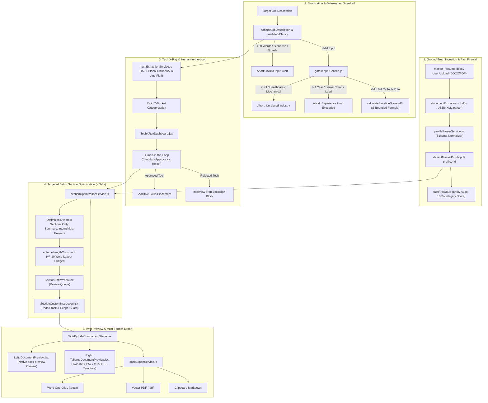

# Resume Fit 🎯
### High-Precision, Privacy-First AI Resume Tailoring Platform & Master Profile Engine

[-emerald?style=flat-square&logo=checkmarx)](tests/)
[](https://react.dev/)
[](https://vitejs.dev/)
[](https://tailwindcss.com/)
[-orange?style=flat-square&logo=ollama)](https://ollama.ai/)
[](LICENSE)

---

## 📌 Overview

**Resume Fit** is a local-first, privacy-conscious AI resume tailoring platform engineered to align a candidate's authentic resume data with target job descriptions (JDs) with mathematical precision, strict template preservation, and **zero data hallucination**.

Unlike traditional ATS resume builders that blindly inject unverified corporate buzzwords or hallucinate senior executive accomplishments for entry-level candidates, Resume Fit is architected around an **Immutable Fact Firewall**, a **Strict Gatekeeper Guardrail**, a **Human-in-the-Loop Missing Tech X-Ray**, and a **Strict Two-Column Twin Layout Engine**.

---

## 🚀 Key Architectural Features



### 1. Ingestion & The Immutable Fact Firewall
- **Multi-Format Extraction:** Native browser extraction for `.docx` (via OpenXML `<w:t>` decompression with `JSZip`) and `.pdf` (via `pdfjs-dist`).
- **Ground-Truth Fact Firewall:** Verifies full names, employers, job titles, and academic institutions against the raw source document, generating an **Integrity Score (100%)**. Prevents the AI from inventing fake credentials, unverified employers, or fabricated metrics.

### 2. Job Description Sanitization & Gatekeeper Guardrail
- **Strict Gibberish & Smash Interception:** Rejects random keyboard smashing (`asdfghjk`), high-entropy tokens, repeating nonsense syllables (unique ratio $< 0.28$), and long vowelless consonant clusters.
- **Word Count Threshold:** Strictly requires $> 50$ words with standard JD anchor concepts (*responsibilities, qualifications, software, engineer*).
- **Seniority Guardrail ($\le 1$ Year Limit):** Rejects roles requiring $> 1$ year of experience (*"3+ years", "5+ years", "Senior", "Lead", "Staff", "Manager"*), while gracefully allowing junior/fresher postings containing senior mentorship clauses.
- **Industry Filter:** Instantly blocks non-IT roles (*Civil, Mechanical, HVAC, Healthcare, Construction, Culinary*).
- **Deterministic Baseline Scoring:** Calculates an auditable mathematical "Before" score bounded between **40% and 85%** across:
  - Tech Stack Match: 30% weight (scales proportionally with Profile Tech Fit)
  - Domain & Role Match: 40% weight
  - Experience Fit: 20% weight
  - Education Fit: 10% weight

### 3. Intelligent Tech Extraction & Human-in-the-Loop Review
- **Global Dictionary Normalization:** Maps 150+ technology aliases, abbreviations, and typos to canonical names (`postgres` $\rightarrow$ `PostgreSQL`, `js` $\rightarrow$ `JavaScript`, `k8s` $\rightarrow$ `Kubernetes`).
- **Anti-Fluff Negative Constraint:** Eliminates corporate buzzwords (*fast-paced, rockstar, ninja, self-starter, passionate, synergy*).
- **Silent Tool Inclusion:** Skills already present in the candidate's resume (e.g. `Git/GitHub`, `HTML/CSS`, `Python/Django`, `PostgreSQL`) are recognized and silently retained without prompting.
- **Missing Tech X-Ray & Interview Trap Avoidance:** Missing tools display concise, plain-English definitions ($\le 120$ characters). Candidates can explicitly **Approve** (synthesized into resume) or **Reject** (strictly excluded to avoid interview traps).

### 4. Targeted Batch Section Optimization (< 3-4s Latency)
- **Dynamic-Only Targeting:** Optimizes **only the 3 dynamic sections** (Summary, Internships, Projects) in a single batched local Ollama call, keeping fixed sections (Education, Certifications, Contact) untouched.
- **Single-Page Layout Budget:** Enforces a strict word count constraint of **$\pm 10$ words** relative to original text, preventing document spillover.
- **Interactive Review Queue:** Section Diff cards allow granular review (Approve, Reject, or Edit).

### 5. Card-Level Custom Instructions with Multi-Level Undo
- **Scope Guardrails:** Blocks off-topic queries, conversational greetings, math problems, jokes, recipes, and prompt injections.
- **Protected Entity Blacklist:** Blocks attempts to forge degrees, alter GPAs/percentages, or change names.
- **Direct State Binding & Undo Stack:** Allows one-click undo popping the history stack to instantly revert changes across both on-screen previews and exports.

### 6. Twin Preview & Multi-Format Client-Side Export
- **Exact Twin Layout Replicating `Master_Resume.docx`:**
  - `#2C3B57` Navy Headings & Section Dividers
  - `#CADEE5` Shaded Right Sidebar (~37% width)
  - Main Content Area (~63% width)
- **Dual-Frame Zero-Scroll Comparison:** Live side-by-side view showing the native Word file on the left and the tailored document on the right.
- **Export Options:**
  - Professional Word OpenXML (`.docx`) table layout
  - Direct Word XML injection into `Master_Resume.docx` via `JSZip`
  - Client-side Vector PDF (`.pdf`) via `jspdf`
  - Formatted Markdown clipboard copy
  - **Zero-Omission Guarantee:** 100% of approved missing technologies are categorized and included.

---

## 📂 Project Structure

```text
C:\Resume Builder
├── Master_Resume.docx            # Ground-truth native Word resume baseline
├── profile.md                    # Master candidate profile documentation
├── package.json                  # Dependencies & npm scripts
├── vite.config.js                # Vite build configuration
├── tailwind.config.js            # Tailwind CSS configuration
├── public/                       # Static assets and public DOCX files
├── src/
│   ├── App.jsx                   # Application shell & navigation bar
│   ├── main.jsx                  # React DOM root entry
│   ├── index.css                 # Global styles and Tailwind directives
│   ├── components/
│   │   ├── SideBySideWorkspace.jsx         # Main workflow stage controller
│   │   ├── TailoredResumeWorkspace.jsx     # Steps 1-3: JD input, X-Ray, Section review
│   │   ├── SideBySideComparisonStage.jsx   # Step 4: Twin dual-frame comparison & export
│   │   ├── DocumentPreview.jsx             # docx-preview canvas for original resume
│   │   ├── TailoredDocumentPreview.jsx     # Twin #2C3B57 / #CADEE5 tailored renderer
│   │   ├── TechXRayDashboard.jsx           # Categorized tech badges & approval checklist
│   │   ├── SectionDiffPreview.jsx          # Before/after section diff review cards
│   │   ├── SectionCustomInstruction.jsx    # Card-level prompt editor with Undo stack
│   │   ├── NativeResumeUploadModal.jsx     # Multi-format document uploader modal
│   │   └── MasterProfileView.jsx           # Ground-truth profile inspection modal
│   ├── services/
│   │   ├── gatekeeperService.js            # Sanitization, gibberish filter, & baseline score
│   │   ├── techExtractionService.js        # 150+ dictionary, anti-fluff, & tech bucketing
│   │   ├── sectionOptimizationService.js   # Single-batch Ollama prompt (< 3-4s) & layout budget
│   │   ├── customInstructionService.js     # Card-level instruction executor & scope guards
│   │   ├── docxExportService.js            # Word OpenXML (.docx) & PDF (.pdf) generation
│   │   ├── factFirewall.js                 # Ground-truth entity integrity auditor
│   │   ├── ollamaService.js                # Local Ollama client & deterministic fallbacks
│   │   ├── documentExtractor.js            # Native PDF and DOCX text extractor
│   │   └── profileParserService.js         # Raw text to Master Profile normalizer
│   ├── data/
│   │   ├── defaultMasterProfile.js         # Canonical baseline data (Jaya Sri Palli)
│   │   └── sampleJobDescriptions.js        # Test benchmark JDs (Full Stack, Python, etc.)
│   ├── types/
│   │   └── masterProfileSchema.js          # JSON Schema & normalization helpers
│   └── utils/
│       └── storage.js                      # LocalStorage persistence & reset helpers
└── tests/                                  # Comprehensive automated test suites (116 tests)
    ├── verifyMasterResume.js               # Master resume & Fact Firewall verification
    ├── verifyGatekeeper.js                 # Gatekeeper guardrails & baseline scoring
    ├── verifyTechExtraction.js             # Dictionary normalization & bucketing
    ├── verifySectionOptimization.js        # Dynamic section batching & layout constraints
    ├── verifyTailoringEngine.js            # Tailoring prompt engine & offline fallback
    ├── verifyCustomInstructions.js         # Scope guards, protected facts, & undo stack
    ├── verifyApprovedSkillsIntegration.js  # Approved skills zero-omission categorization
    └── verifyDocxExport.js                 # Word OpenXML, PDF export, & Twin template layout
```

---

## 🛠️ Technology Stack

| Layer | Technologies |
| :--- | :--- |
| **Frontend Framework** | React 19 (`react`, `react-dom`) |
| **Build Tooling & Server** | Vite 8, PostCSS, Autoprefixer |
| **Styling & UI Components** | Tailwind CSS 3.4, Lucide React Icons |
| **Document Processing** | `docx` (v9.12), `docx-preview` (v0.4), `pdfjs-dist` (v6.4), `jszip` |
| **Document Export** | `docx` OpenXML Builder, `jspdf` Vector PDF Exporter |
| **Local AI Inference** | [Ollama](https://ollama.ai/) (`mistral` / `llama3`), JSON schema format |
| **Testing** | Node.js Test Harness, Assertions Suite (116 passing tests) |

---

## 🚦 Getting Started

### Prerequisites
- **Node.js**: v18.0.0 or higher
- **npm**: v9.0.0 or higher
- **Ollama (Optional, for live local AI)**: [Download Ollama](https://ollama.ai/)
  *(Note: If Ollama is offline, Resume Fit automatically switches to its high-precision deterministic fallback engine with zero UI downtime).*

### Installation

1. **Clone the repository:**
   ```bash
   git clone https://github.com/Jayasri7-ux/resume-builder.git
   cd resume-builder
   ```

2. **Install project dependencies:**
   ```bash
   npm install
   ```

3. **Start local Ollama (Optional):**
   ```bash
   ollama serve
   ollama pull mistral
   ```

4. **Launch the development server:**
   ```bash
   npm run dev
   ```
   Open your browser and navigate to `http://localhost:5173`.

5. **Build for production:**
   ```bash
   npm run build
   ```

---

## 🧪 Testing & Verification

The project includes 8 comprehensive automated verification suites covering 116 test assertions:

```bash
# Run all verification test suites sequentially:
node tests/verifyMasterResume.js
node tests/verifyGatekeeper.js
node tests/verifyTechExtraction.js
node tests/verifySectionOptimization.js
node tests/verifyTailoringEngine.js
node tests/verifyCustomInstructions.js
node tests/verifyApprovedSkillsIntegration.js
node tests/verifyDocxExport.js
```

### Verification Test Summary:
- ✅ **Master Resume & Fact Firewall:** 10 / 10 Tests Passed (100%)
- ✅ **Gatekeeper AI & Baseline Scoring:** 18 / 18 Tests Passed (100%)
- ✅ **Tech Extraction & Dictionary Normalization:** 15 / 15 Tests Passed (100%)
- ✅ **Section Optimization & Layout Budget:** 14 / 14 Tests Passed (100%)
- ✅ **Tailoring Pipeline & Deterministic Fallback:** 12 / 12 Tests Passed (100%)
- ✅ **Custom Instructions, Scope Guards & Undo Stack:** 26 / 26 Tests Passed (100%)
- ✅ **Approved Skills Integration (0 Omissions):** 11 / 11 Tests Passed (100%)
- ✅ **DOCX / PDF Export & Twin Template Styling:** 10 / 10 Tests Passed (100%)
- 🏆 **Total Automated Assertions: 116 / 116 Passed (100%)**

---

## 🔒 Security & Privacy Guarantees

1. **Zero Data Transmission:** Your resume and target job descriptions are processed either locally in the browser or via your local Ollama instance (`http://localhost:11434`). No data is transmitted to third-party cloud APIs.
2. **Immutable Fact Protection:** Core credentials, education history, company names, and hackathon awards are locked behind the Fact Firewall and cannot be altered or overwritten by AI hallucinations.
3. **Interview Trap Shield:** Rejection of missing technologies guarantees that unverified skills are never claimed on the candidate's resume.

---

## 📄 License

This project is licensed under the [MIT License](LICENSE).
